# Caelestia Spatial & Infinite Canvas Display System

**Original Author & Creator:** [Mohammed Awad](https://github.com/Mohammed-Awad-ENG)  
*Free to use, customize, and fork with attribution.*

[](https://hyprland.org)
[](https://quickshell.outfoxxed.me)
[](https://github.com/caelestia-dots)
[](https://github.com/opencode-ai)

An advanced, non-invasive window management and infinite spatial canvas display system built for **Hyprland** using the **Quickshell / Caelestia** desktop shell ecosystem. 

It provides seamless switching between **Custom 2D Spatial Tree**, **Columns Scrollable Strip**, and **Freeform (Native Compositor)**, complete with a real-time **2D Minimap Popout** supporting drag-and-drop layout manipulation, multi-app **Freeform Places**, directional spawn controls, and automatic gap compaction.

---

> [!TIP]
> ### 🤖 Recommended AI Coding Assistant: OpenCode
> If you are setting up, customizing, or maintaining this repository using an autonomous coding assistant, we strongly recommend **[OpenCode](https://github.com/opencode-ai)** (`ai.opencode.desktop`).
> 
> **Why OpenCode?**
> - **Deep Linux & Wayland Native Support**: OpenCode runs directly in your native environment, seamlessly testing Hyprland dispatchers and Quickshell IPC calls without containerization hurdles.
> - **Autonomous Multi-File Agent Execution**: OpenCode can read this entire guide, execute the automated [`install.sh`](install.sh) script, verify daemon status, and resolve dotfile conflicts automatically.
> - **Safe Dotfile Management**: Automatically inspects, diffs, and backs up existing configuration files before applying patches.

---

## Table of Contents

1. [Architectural Overview](#architectural-overview)
2. [Display Modes](#display-modes)
   - [Mode 1: Custom 2D Spatial Canvas](#1-custom-2d-spatial-canvas)
   - [Mode 2: Columns Scrollable Strip](#2-columns-scrollable-strip)
   - [Mode 3: Freeform (Native Compositor)](#3-freeform-native-compositor)
3. [Multi-App "Freeform Place" in 2D Space](#multi-app-freeform-place-in-2d-space)
4. [Visual 2D Minimap Popout & Gestures](#visual-2d-minimap-popout--gestures)
5. [Complete Shortcuts Cheatsheet](#complete-shortcuts-cheatsheet)
6. [Repository Structure](#repository-structure)
7. [Installation Guide](#installation-guide)
   - [Automated 1-Step Installation](#automated-1-step-installation)
   - [AI Agent Automated Installation Protocol](#ai-agent-automated-installation-protocol)
   - [Manual Step-by-Step Installation](#manual-step-by-step-installation)
8. [Verification & Smoke Tests](#verification--smoke-tests)
9. [Troubleshooting & FAQ](#troubleshooting--faq)

---

## Architectural Overview

Unlike traditional window managers that require modifying compositor C++ source code or installing unstable C++ plugins, this display system operates **100% cleanly in user space**:

```mermaid
flowchart TD
    subgraph Compositor ["Hyprland (Wayland Compositor)"]
        HYPR["Hyprland Socket / IPC"]
        WIN["Managed Windows (Toplevels)"]
    end

    subgraph CaelestiaShell ["Caelestia Quickshell Daemon (QML + JS)"]
        STATE["LayoutState.qml\n(Workspace state, modes, floatSlots)"]
        CANVAS["SpatialCanvas.js\n(2D Graph, Dwindle Math, Compaction, Minimap)"]
        ENGINE["LayoutEngine.js\n(Hyprland Dispatch Bridge)"]
        MAP["LayoutMapPopout.qml\n(Visual Minimap + Drag & Drop)"]
        SHORTCUTS["Shortcuts.qml\n(Custom Shortcuts + IPC Handler)"]
    end

    WIN -->|Window events: open, close, focus| HYPR
    HYPR -->|IPC events| STATE
    SHORTCUTS -->|Keybinding triggers| STATE
    STATE --> CANVAS
    CANVAS --> ENGINE
    ENGINE -->|hyprctl dispatch movewindowpixel / resizewindowpixel| HYPR
    STATE -.->|Reactive state updates| MAP
```



### Core Design Principles

1. **Non-Invasive**: No custom Hyprland forks or unsafe binary modules. It uses official Hyprland IPC socket events and Lua/C++ dispatchers (`movewindowpixel`, `resizewindowpixel`, `focuswindow`).
2. **Camera Coordinate Matrix**: Each window is mapped to an $(x, y)$ coordinate in a virtual 2D space. The "camera" focuses on the active window, translating and positioning all connected neighbors relative to the physical monitor viewport.
3. **Dead Window Pruning**: Clean event-driven pruning ensures that closed applications are instantly removed from the coordinate map, eliminating ghost windows across all modes.

---

## Display Modes

Cycle between modes anytime with <kbd>SUPER</kbd> + <kbd>G</kbd> (or <kbd>SUPER</kbd> + <kbd>ALT</kbd> + <kbd>G</kbd>).

### 1. Custom 2D Spatial Canvas

An infinite 2D canvas where applications branch out directionally:

```
          [ Browser ] (0, -1)
               ↑
 [ Terminal ] ← [ Active App ] → [ Editor ] (1, 0)
   (-1, 0)         (0, 0)
               ↓
          [ Discord ] (0, 1)
```

- **Two Sizing Viewports** (<kbd>SUPER</kbd> + <kbd>F</kbd>):
  - **Cluster View (50% Width)**: Active window occupies 50% width; adjacent left and right neighbors peek into view from the monitor edges.
  - **100% Focused View**: The active window (or multi-app Float Place) expands to fill 100% of the screen within system gaps and status bar.
- **Directional Navigation**: Use <kbd>SUPER</kbd> + <kbd>←</kbd> <kbd>→</kbd> <kbd>↑</kbd> <kbd>↓</kbd> (or <kbd>SUPER</kbd> + <kbd>ALT</kbd> + Arrow) to pan the camera across the 2D plane.
- **Directional Target Preselection**: Press <kbd>SUPER</kbd> + <kbd>SHIFT</kbd> + <kbd>←</kbd> <kbd>→</kbd> <kbd>↑</kbd> <kbd>↓</kbd> before opening an app to force the next launched window to spawn in that direction. Alternatively, press <kbd>SUPER</kbd> + <kbd>ALT</kbd> + <kbd>D</kbd> to cycle the default spawn direction.
- **Attach / Move Window**: Press <kbd>SUPER</kbd> + <kbd>CTRL</kbd> + <kbd>←</kbd> <kbd>→</kbd> <kbd>↑</kbd> <kbd>↓</kbd> to shift the active window relative to its neighbors.
- **Automatic Gap Healing (`compact2D`)**: Closing an intermediate window automatically pulls outer branches inward to keep the spatial graph dense and connected.

---

### 2. Columns Scrollable Strip

A continuous, scrollable ribbon of application columns:

```
[ App 1 ] [ App 2 (Focused) ] [ App 3 ] [ App 4 ] ──→ Infinite Ribbon
```

- **Continuous Ribbon**: Windows are placed sequentially along a horizontal (or vertical) ribbon.
- **Dynamic Width Ratios**:
  - <kbd>SUPER</kbd> + <kbd>ALT</kbd> + <kbd>=</kbd> (or <kbd>+</kbd>, <kbd>]</kbd>): Widen column ($33\% \to 50\% \to 67\% \to 100\%$).
  - <kbd>SUPER</kbd> + <kbd>ALT</kbd> + <kbd>-</kbd> (or <kbd>[</kbd>): Narrow column ($100\% \to 67\% \to 50\% \to 33\%$).
- **Camera Tracking**: Navigating left or right automatically scrolls the strip to center the focused application.

---

### 3. Freeform (Native Compositor)

The default native compositor mode:
- Hyprland's native dwindle auto-tiling and floating window rules take control.
- **True Monitor Geometry Minimap**: The 2D minimap popout computes and renders window tiles based on their real on-screen pixel coordinates (`at` and `size`), accurately mirroring splits and floating geometries.

---

## Multi-App "Freeform Place" in 2D Space

In **Custom 2D Canvas mode at 100% focused view**, any spatial coordinate slot $(x, y)$ can be transformed into a multi-app **Freeform Place**:

```
(0, 0) [ Kitty Terminal ]
  ↓
(1, 0) [ Brave Browser ]
  ↓
(2, 0) [ Firefox | Antigravity | OpenCode ]  <-- Freeform Place (Dwindle Split)
```

### Key Capabilities

1. **Native Dwindle Auto-Tiling**: Inside that single $100\%$ slot, multiple windows partition dynamically using binary space partitioning (alternating vertical/horizontal splits).
2. **Unified Camera Translation**: When panning the spatial camera away from that slot, all grouped windows pan off-screen together as a unified node.
3. **Internal Directional Focus**: Arrow navigation first navigates focus between split windows *inside* the Freeform Place; navigating past the outer edge pans the camera to adjacent spatial nodes.
4. **How to Toggle / Create**:
   - **Keyboard Shortcut**: Press <kbd>SUPER</kbd> + <kbd>ALT</kbd> + <kbd>F</kbd> on the active slot. While enabled, new windows opened from this slot automatically join the group.
   - **Minimap Drag & Drop**: Open the minimap (<kbd>SUPER</kbd> + <kbd>SHIFT</kbd> + <kbd>G</kbd>) and drag an app card directly onto another occupied tile.
   - **Count Badge**: Freeform Places with $\ge 2$ windows display a count badge (e.g. `[3]`) in the top-right corner of the minimap card.

---

## Visual 2D Minimap Popout & Gestures

Press <kbd>SUPER</kbd> + <kbd>SHIFT</kbd> + <kbd>G</kbd> (or click the Layout icon in the taskbar) to open the interactive minimap:

```
┌────────────────────────────────────────────────────────┐
│ Workspace 1 — Custom 2D Canvas                       ✕ │
├────────────────────────────────────────────────────────┤
│                     ┌──────────┐                       │
│                     │  Browser │                       │
│                     └────┬─────┘                       │
│                          │                             │
│     ┌──────────┐    ┌────┴─────┐    ┌──────────┐ [3]   │
│     │ Terminal │ ←─ │  Editor* │ ─→ │ DevGroup │       │
│     └──────────┘    └──────────┘    └──────────┘       │
│                                                        │
├────────────────────────────────────────────────────────┤
│ [ Columns ]       [ Custom 2D ]*       [ Freeform ]     │
├────────────────────────────────────────────────────────┤
│ View:  [ Cluster (50%) ]*   [ Focused (100%) ]  [ Reset]│
└────────────────────────────────────────────────────────┘
```

- **Interactive Drag & Drop**:
  - **Drop onto an occupied tile**: Groups the app into that slot as a multi-app Freeform Place.
  - **Drop between tiles (edges)**: Snaps and inserts a new column or row, shifting neighboring nodes outward.
- **Direct Travel**: Click any card in the minimap to immediately pan the camera and focus that window.
- **Live Active Outline**: The currently focused application displays a vibrant primary highlight ring.
- **Directional Connection Arrows**: Vector arrows indicate layout topology between nodes.

---

## Complete Shortcuts Cheatsheet

All shortcuts are registered in Caelestia's global cheatsheet (<kbd>SUPER</kbd> + <kbd>/</kbd>) under the **Spatial** tag:

| Category | Shortcut | Description |
| :--- | :--- | :--- |
| **Mode & Minimap** | <kbd>SUPER</kbd> + <kbd>G</kbd> / <kbd>SUPER</kbd> + <kbd>ALT</kbd> + <kbd>G</kbd> | Cycle layout mode (Freeform $\to$ Columns $\to$ Custom 2D) |
| | <kbd>SUPER</kbd> + <kbd>SHIFT</kbd> + <kbd>G</kbd> | Toggle Visual 2D Minimap Popout |
| **Spatial Navigation** | <kbd>SUPER</kbd> + <kbd>←</kbd> <kbd>→</kbd> <kbd>↑</kbd> <kbd>↓</kbd> | Navigate directionally in 2D space (left, right, up, down) |
| | <kbd>SUPER</kbd> + <kbd>ALT</kbd> + <kbd>←</kbd> <kbd>→</kbd> <kbd>↑</kbd> <kbd>↓</kbd> | Directional navigation alternative |
| | <kbd>SUPER</kbd> + <kbd>Tab</kbd> / <kbd>ALT</kbd> + <kbd>Tab</kbd> | Cycle focus forward in spatial tree sequence |
| | <kbd>SUPER</kbd> + <kbd>SHIFT</kbd> + <kbd>Tab</kbd> / <kbd>ALT</kbd> + <kbd>SHIFT</kbd> + <kbd>Tab</kbd> | Cycle focus backward in spatial tree sequence |
| **Window Sizing** | <kbd>SUPER</kbd> + <kbd>F</kbd> | Toggle active window size (100% monitor viewport vs 50% cluster) |
| | <kbd>SUPER</kbd> + <kbd>SHIFT</kbd> + <kbd>F</kbd> | Toggle true compositor fullscreen (hides bar) |
| | <kbd>SUPER</kbd> + <kbd>ALT</kbd> + <kbd>=</kbd> / <kbd>+</kbd> / <kbd>]</kbd> | Widen Columns column width ratio |
| | <kbd>SUPER</kbd> + <kbd>ALT</kbd> + <kbd>-</kbd> / <kbd>[</kbd> | Narrow Columns column width ratio |
| **Freeform Place** | <kbd>SUPER</kbd> + <kbd>ALT</kbd> + <kbd>F</kbd> | Toggle active slot as a multi-app Freeform Place |
| | `Minimap Drag onto Slot` | Drop app card onto occupied slot in 2D minimap to group into Freeform Place |
| | <kbd>SUPER</kbd> + <kbd>←</kbd> <kbd>→</kbd> <kbd>↑</kbd> <kbd>↓</kbd> *(inside slot)* | Directional focus between split windows inside Freeform Place |
| **Target Placement** | <kbd>SUPER</kbd> + <kbd>SHIFT</kbd> + <kbd>←</kbd> <kbd>→</kbd> <kbd>↑</kbd> <kbd>↓</kbd> | Preselect spawn direction (Up, Down, Left, Right) for next app |
| | <kbd>SUPER</kbd> + <kbd>ALT</kbd> + <kbd>D</kbd> | Cycle default spawn direction (Right $\to$ Down $\to$ Left $\to$ Up) |
| | <kbd>SUPER</kbd> + <kbd>CTRL</kbd> + <kbd>←</kbd> <kbd>→</kbd> <kbd>↑</kbd> <kbd>↓</kbd> | Move or attach active window in direction relative to neighbors |
| **Maintenance** | <kbd>SUPER</kbd> + <kbd>ALT</kbd> + <kbd>Backspace</kbd> | Reset spatial coordinates and re-center layout |

---

## Repository Structure

```
├── README.md                      # Complete system documentation
├── install.sh                     # Automated 1-step installer
├── modules/
│   └── layout/
│       ├── SpatialCanvas.js       # Core 2D geometry, Dwindle BSP, compaction, minimap
│       ├── LayoutEngine.js        # Hyprland IPC command dispatcher
│       ├── LayoutState.qml        # Workspace state singleton, events, reactive sync
│       ├── LayoutMapPopout.qml    # Visual 2D minimap popout with drag-and-drop
│       ├── LayoutButton.qml       # Taskbar layout status & toggle button
│       ├── CustomModeControls.qml # Custom 2D sub-controls panel
│       ├── PaperModeControls.qml  # Columns sub-controls panel
│       └── PlacementOverlay.qml   # Visual on-screen placement HUD
└── integrations/
    ├── hyprland_snippet.lua       # Hyprland keybindings snippet
    ├── Shortcuts_snippet.qml      # Shortcuts.qml IPC & action bindings
    ├── Bar_snippet.qml            # Bar.qml button & popout integration
    └── Content_snippet.qml        # Popout container registration
```

---

## Installation Guide

### Prerequisites
- **Linux Distribution**: Fedora, Arch Linux, openSUSE, Ubuntu, etc.
- **Compositor**: [Hyprland](https://hyprland.org) ($\ge v0.40$)
- **Shell**: [Quickshell](https://quickshell.outfoxxed.me) ($\ge v0.0.9$) with Caelestia dotfiles installed in `~/.config/quickshell/caelestia`.
- **System Utilities**: `jq`, `grim` (for minimap / area picker features).

---

### Automated 1-Step Installation

Clone this repository and run the installer:

```bash
git clone https://github.com/YOUR_USERNAME/caelestia-spatial-layout.git
cd caelestia-spatial-layout
./install.sh
```

The script will automatically:
1. Create a timestamped backup of your existing configs in `~/.config/caelestia-backup-<date>`.
2. Copy layout modules into `~/.config/quickshell/caelestia/modules/layout/`.
3. Safely merge keybindings into `~/.config/hypr/hyprland.lua`.
4. Inject IPC handlers into `~/.config/quickshell/caelestia/modules/Shortcuts.qml`.
5. Register the minimap popout in `~/.config/quickshell/caelestia/modules/bar/popouts/Content.qml`.
6. Restart the Caelestia daemon and run an IPC smoke test.

---

### AI Agent Automated Installation Protocol

If you are an **AI Agent** (such as **OpenCode**), execute the following deterministic protocol:

1. **Verify Target Paths**:
   ```bash
   test -d "$HOME/.config/quickshell/caelestia" && echo "Caelestia present"
   test -f "$HOME/.config/hypr/hyprland.lua" && echo "Hyprland Lua present"
   ```
2. **Deploy Layout Directory**:
   ```bash
   mkdir -p "$HOME/.config/quickshell/caelestia/modules/layout"
   cp -r modules/layout/* "$HOME/.config/quickshell/caelestia/modules/layout/"
   ```
3. **Verify or Inject Hyprland Keybindings**:
   Check if `caelestia:layout` is in `~/.config/hypr/hyprland.lua`. If not, append `integrations/hyprland_snippet.lua`.
4. **Verify or Inject Shortcuts & IPC**:
   Check if `target: "layout"` is in `~/.config/quickshell/caelestia/modules/Shortcuts.qml`. If not, insert `integrations/Shortcuts_snippet.qml`.
5. **Restart Shell Daemon**:
   ```bash
   pkill -f "qs -c caelestia" || true
   sleep 0.5
   caelestia shell -d
   ```
6. **Verify Responsive IPC**:
   ```bash
   qs -c caelestia ipc call layout cycle
   ```

---

### Manual Step-by-Step Installation

#### Step 1: Copy Layout Modules
```bash
cp -r modules/layout ~/.config/quickshell/caelestia/modules/
```

#### Step 2: Add Hyprland Keybindings
Append the contents of [`integrations/hyprland_snippet.lua`](integrations/hyprland_snippet.lua) to your `~/.config/hypr/hyprland.lua`.

#### Step 3: Register IPC in `Shortcuts.qml`
In `~/.config/quickshell/caelestia/modules/Shortcuts.qml`, add:
```qml
import "./layout"
```
And inside the root `Scope { ... }`, append the custom shortcuts and IPC handler from [`integrations/Shortcuts_snippet.qml`](integrations/Shortcuts_snippet.qml).

#### Step 4: Register Popout in `Content.qml`
In `~/.config/quickshell/caelestia/modules/bar/popouts/Content.qml`, add:
```qml
import "../../layout"

Popout {
    name: "layoutmap"
    sourceComponent: LayoutMapPopout {
        popouts: root.popouts
    }
}
```

#### Step 5: Reload Daemon
```bash
caelestia shell -r
# or detached:
caelestia shell -d
```

---

## Verification & Smoke Tests

Run these terminal commands to verify that every layer of the system is functioning correctly:

```bash
# 1. Verify Caelestia Quickshell daemon is running
pgrep -a qs

# 2. Test layout mode cycling via IPC
qs -c caelestia ipc call layout cycle

# 3. Test setting mode directly to custom
qs -c caelestia ipc call layout set custom

# 4. Open the 2D visual minimap
hyprctl dispatch 'hl.dsp.global("caelestia:layoutMap")'

# 5. Check Quickshell log stream for any QML errors
caelestia shell -l | tail -n 25
```

---

## Troubleshooting & FAQ

### Q: Why do windows float instead of tiling when switching to Custom 2D?
In Custom 2D and Columns modes, Caelestia controls window positioning via Hyprland's `movewindowpixel` and `resizewindowpixel` dispatchers. This is intentional: it allows true pixel-perfect camera panning and smooth transitions. When switching back to **Freeform (Native)** mode, Caelestia calls `_unfloatAll()` to return windows to native Hyprland dwindle tiling.

### Q: How do I reset the canvas if windows become misaligned?
Press <kbd>SUPER</kbd> + <kbd>ALT</kbd> + <kbd>Backspace</kbd> or run:
```bash
qs -c caelestia ipc call layout reset
```
This re-centers the active window and resets all coordinates.

### Q: The minimap does not open when clicking the bar button.
Ensure `LayoutMapPopout.qml` is registered in `~/.config/quickshell/caelestia/modules/bar/popouts/Content.qml` with `name: "layoutmap"`. Check `caelestia shell -l` for any missing component warnings.

---

## Author & License

Created by **Mohammed Awad** ([@Mohammed-Awad-ENG](https://github.com/Mohammed-Awad-ENG)).  
This display system is free to use, modify, and fork under the [MIT License](LICENSE) with author attribution.

Contributions are welcome! Please ensure that:
1. Documentation integrity and clean QML styling are maintained.
2. Changes to `SpatialCanvas.js` preserve `compact2D` gap healing and Float Place grouping logic.
3. Tests are verified in a Wayland session before submitting PRs.
